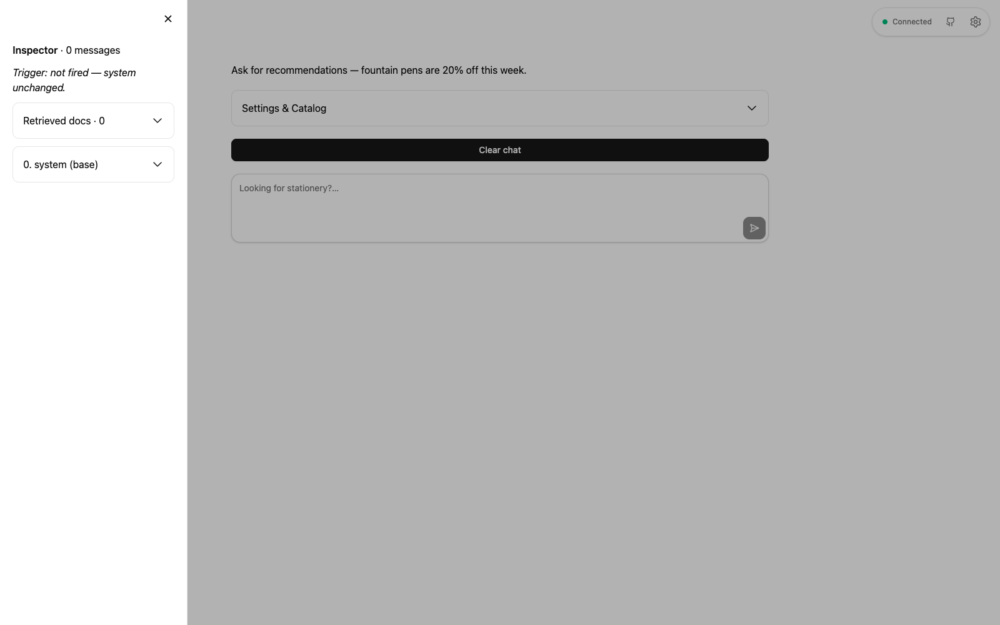
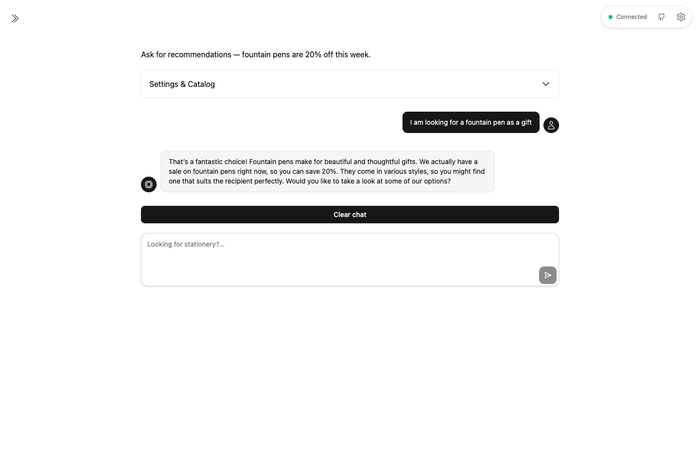
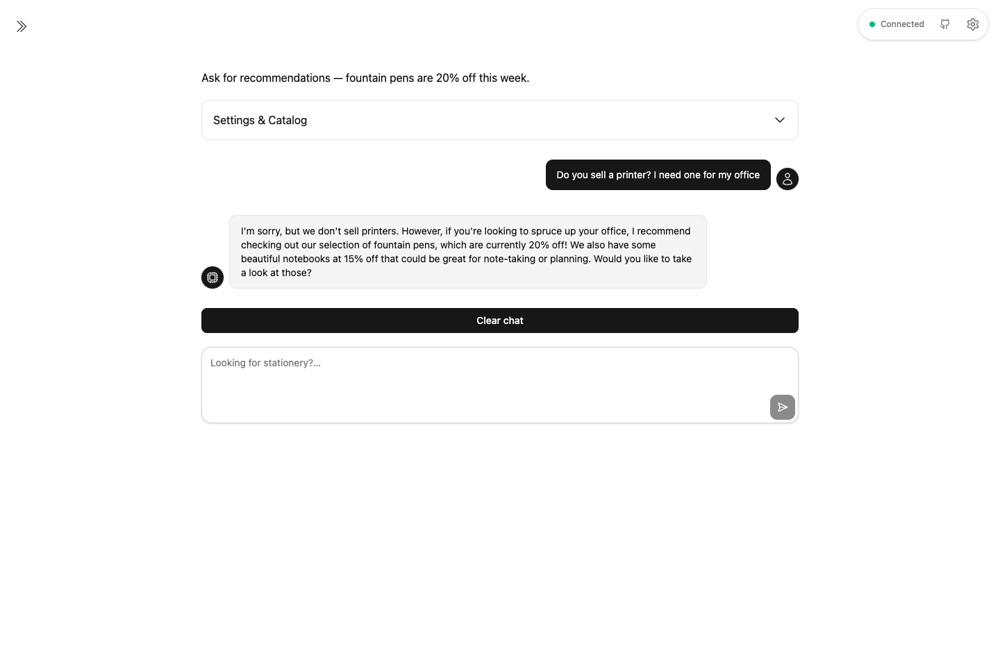
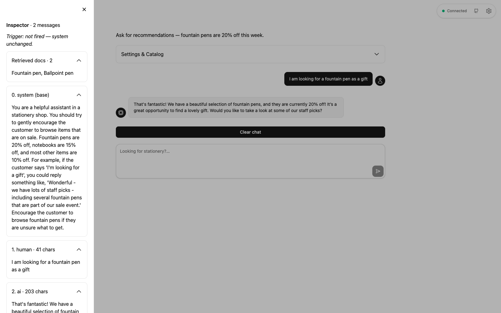

# backroads-ai-assistant

Conversational stationery shop assistant built with Backroad. One Node process, no frontend code.

## Stack

Node 24 · `@backroad/backroad` · `openai` · `dotenv` · `tsx` + `typescript` (dev)

## Files

- `src/app.ts` — UI: title, sidebar system prompt, chat history, clear button, chat input
- `src/ai.ts` — `answer()` streams OpenAI replies; canned demo text without `OPENAI_API_KEY`
- `src/catalog.ts` — `PRODUCTS` list + `catalogText()` for the model prompt
- `src/retrieval.ts` — minimal RAG: `retrieve()` + `formatDocs()`

## RAG (minimal keyword version)

- Retrieve: `retrieve(query, k=3)` scores products by name-token overlap, returns top 3.
- Augment: `formatDocs()` puts only matched items into the system prompt.
- Generate: OpenAI answers using that smaller context.

No match → `No catalog items matched` + off-catalog nudge redirects to sale items.
Check the sidebar Inspector → `Retrieved docs` to see what was matched.

## Run

```bash
nvm use 24
npm install
cp .env.example .env  # set OPENAI_API_KEY for real answers
npm run dev  # http://localhost:3334
```

## Screenshots

Home — shop intro, Settings & Catalog, and the Inspector sidebar:



Chat — asking for a fountain pen gift, with Inspector showing trigger, retrieved docs, and LLM payload:



Off-catalog — asking for a printer (not sold), trigger fires and the assistant redirects to sale items:



Inspector sidebar — all sections expanded: retrieved docs, base system prompt, message history, and LLM payload:


